# Soar EdgeTX BW

F3K and F5J soaring on small black-and-white EdgeTX radios, the RadioMaster
Pocket and the RadioMaster GX12: model templates, a score keeper for the
competition tasks, and setup screens that adjust the model with the trims. The
package builds on the SoarOTX scripts by Jesper Frickmann.

**Guides (PDF)** take a model from the files on the radio to the first flight:

- F3K: [English](docs/guides/SoarEdgeTX-BW-F3K-en.pdf)
- F5J M-tail: [English](docs/guides/SoarEdgeTX-BW-MTail-en.pdf),
  [Russian](docs/guides/SoarEdgeTX-BW-MTail-ru.pdf),
  [Bulgarian](docs/guides/SoarEdgeTX-BW-MTail-bg.pdf)

## F3K

| Tasks, practice, altimeter, scores | Every FAI task, 2026 included | Task N, ready to launch |
| --- | --- | --- |
| 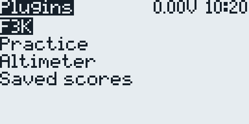 | 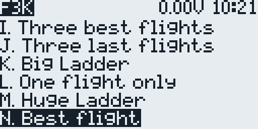 | 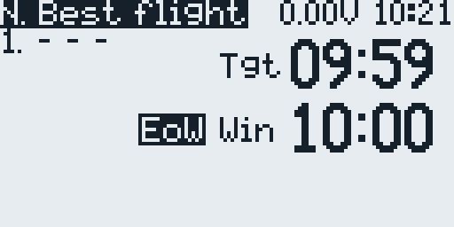 |

| In flight: flight and window time | After the catch: the flight in the list | Switches page |
| --- | --- | --- |
| 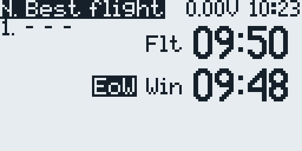 | 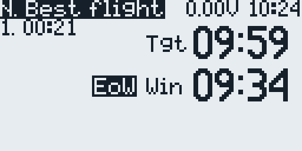 | 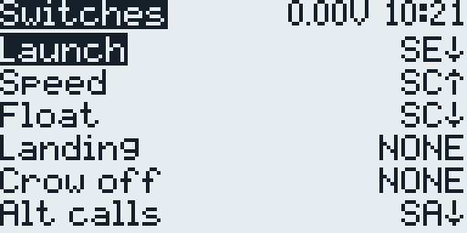 |

- The score keeper times the FAI F3K tasks A to N, with N "Best flight" of the
  2026 rules, plus A2, a last-flight task with a 10-minute window, practice and
  altimeter tasks, and a browser for the saved scores. The launch switch starts
  the window and the flight, and the radio calls the time left and, with an
  altimeter, the launch height. Task notes:
  [F3K_readme.txt](dist/SDCARD/SCRIPTS/TELEMETRY/F3K_readme.txt).
- The template flies two flaperons, the elevator, and the rudder on `CH1` to
  `CH4`, with the flight modes Launch, Zoom, Speed, Cruise, Float, and Landing.
- The throttle stick lands the model: it brings the brakes out and switches on
  the Landing flight mode, with no switch to flip.

## F5J

| Ready: target time 10:00 | Motor armed | Motor run |
| --- | --- | --- |
| 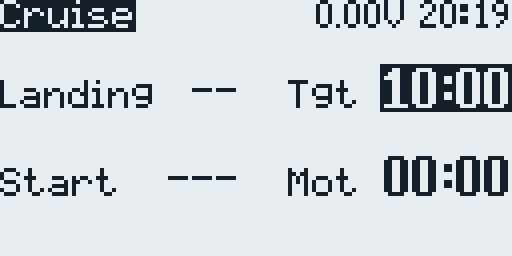 |  | 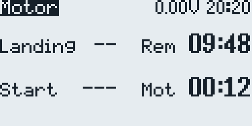 |

| Glide: working time left | Landing points | EXIT or SAVE |
| --- | --- | --- |
|  |  | 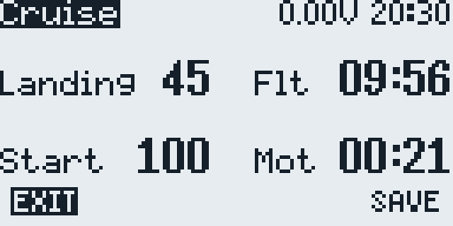 |

| Saved flights | Configuration menu | Switches page (GX12) |
| --- | --- | --- |
| 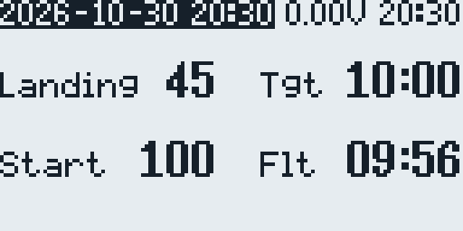 |  | 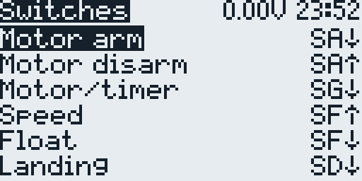 |

- The score keeper follows an F5J flight: arming, motor run, the start height
  after the 10-second count, the working time, and the landing points, saved to
  `/LOGS/JF F5J Scores.csv`.
- The templates fly an X-tail, an M-tail with two elevator servos, or a V-tail,
  with ailerons, flaps, motor, rudder, and elevator on `CH1` to `CH8`. One
  switch arms the motor, another starts it, and `P1` sets the power.

## Setup Screens

The Configuration menu (telemetry screen 2) sets the model up page by page,
mostly with the trims and the throttle stick: the switches first, then the
channels, the wing alignment, the brakes, and the mixes.

| F5J channels and directions | F5J flap and aileron alignment | F5J airbrake curves, elevator included |
| --- | --- | --- |
| 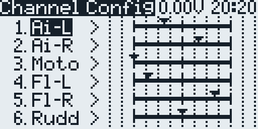 | 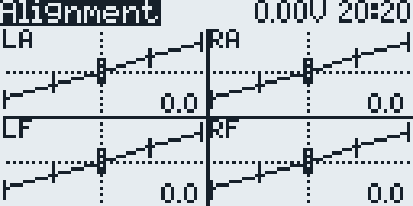 |  |

| F5J aileron and camber | F5J other mixes | F5J motor idle |
| --- | --- | --- |
| 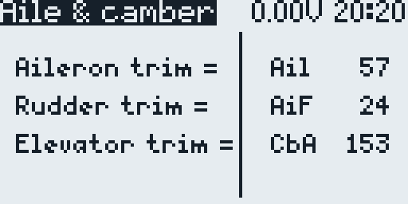 | 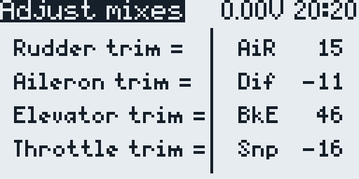 |  |

| Battery warning | F3K menu | F3K channels |
| --- | --- | --- |
| 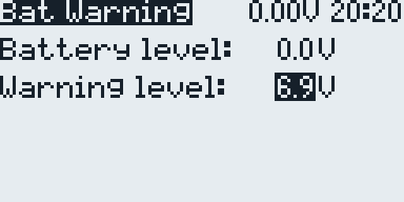 | 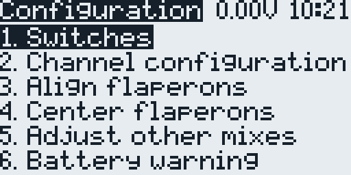 | 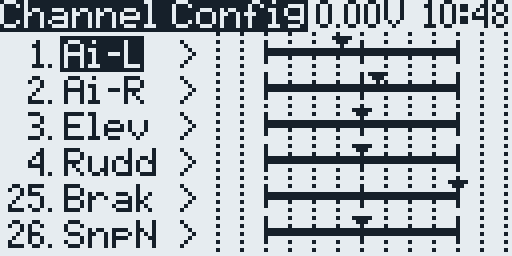 |

| F3K flaperon alignment | F3K flaperon center | F3K other mixes |
| --- | --- | --- |
| 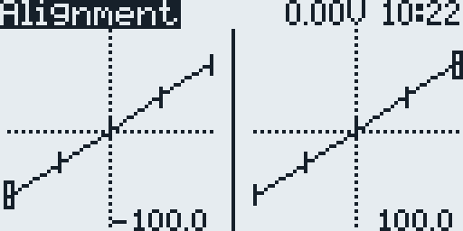 | 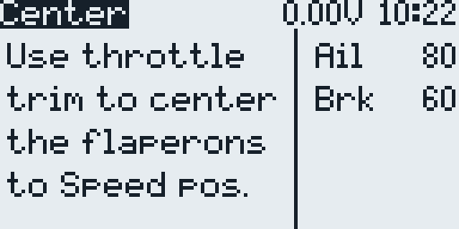 | 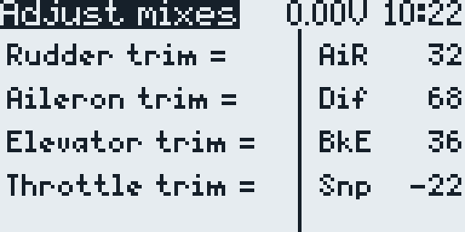 |

## What's new compared to SoarOTX

- **Templates for the Pocket and the GX12**: F3K, and F5J with an X-tail, an
  M-tail, or a V-tail, ready to restore on the radio.
- **F5J M-tail**: two elevator servos, with optional aileron-to-elevator and
  rudder-to-elevator mixes.
- **Switches page**: `1. Switches`, first in the F3K and F5J menus, moves each
  function to another switch on the radio, the GX12's `SW1`-`SW6` buttons
  included, without the logical switch menus.
- **Landing on the throttle stick**: the F3K default and an F5J option. The
  stick brings the brakes out and switches on the Landing flight mode. After a
  launch or a motor run the brakes stay in until the stick has been at the
  bottom, and until then the radio says "Flaps up".
- **Brake elevator compensation in flight**: in the Landing flight mode the
  elevator trim buttons set `BkE`. In F5J the curve `BrE` also shapes it along the brake
  travel, set point by point on `4. Adjust airbrake curves`.
- **Camber on the throttle stick or a slider**: Float camber on the throttle
  stick, or camber on a free slider or pot on top of the throttle trim; the
  guides show the setup.
- **New F3K tasks**: N. Best flight of the 2026 FAI rules, and A2, a last-flight
  task with a 10-minute window.
- **Motor arm and disarm** (F5J): separate arm and disarm switches, a motor stop
  disarms, and the GX12's `SA` button latches and lights.
- **`8. Motor idle`** (F5J): set the lowest motor power with the throttle trim
  while the motor runs.
- **F5J score keeper**: the Save screen offers `EXIT` and `SAVE`, with `EXIT`
  first, and a motor restart in the glide starts a new flight.
- **Aileron trim outside the differential**: the aileron trim moves both
  ailerons by the same amount.
- **EdgeTX fixes**: the setup screens load and stay open on 128x64 radios, and
  the menus write `GV8` only when it changes, so they no longer hold off EdgeTX
  from saving the model.
- **Step-by-step guides**: F3K in English, F5J M-tail in English, Russian, and
  Bulgarian.

## Templates

| Radio | F3K | F5J X-tail | F5J M-tail | F5J V-tail |
| --- | --- | --- | --- | --- |
| RadioMaster Pocket | `pocket-F3K` | `pocket-F5J-XTail` | `pocket-F5J-MTail` | `pocket-F5J-VTail` |
| RadioMaster GX12 | `gx12-F3K` | `gx12-F5J-XTail` | `gx12-F5J-MTail` | `gx12-F5J-VTail` |

The templates are sanitized: no binding, registration, or telemetry data, and
neutral calibration and trims. Set each one up for the aircraft before flight.
The scripts have screens for 128x64 and 212x64 displays, so other
black-and-white EdgeTX radios can run them; the templates are made for the
Pocket and the GX12. The channels, mixes, and switches of the templates, and
how to change them, are in the [reference](docs/reference.md).

## Install

`dist/SDCARD/` mirrors the SD card of the author's radio, with models and
settings besides the package, so copy only the parts below. Back up the radio
first (on the GX12 its internal storage, which appears as the SD card over USB)
and install the standard EdgeTX sound pack for your firmware.

| From `dist/SDCARD/` | To |
| --- | --- |
| `SCRIPTS/TELEMETRY/` (the whole folder) | `/SCRIPTS/TELEMETRY/` |
| `SCRIPTS/FUNCTIONS/JFutil.lua` | `/SCRIPTS/FUNCTIONS/` |
| `TEMPLATES/3.SoarEdgeTx/*.yml` | `/BACKUP/` |
| `SOUNDS/en/*.wav` | `/SOUNDS/en/` |

The package has no compiled `.luac` files; the radio compiles its own. On a card
with an earlier package, delete the old ones, where present: `JFXJcf.luac`,
`JF5Jsk.luac`, `JFXKcf.luac`, and `JF3Ksk.luac` in `/SCRIPTS/TELEMETRY/`, and
`ARMED.luac`, `JFutil.luac`, and `MENU.luac` in `/SCRIPTS/TELEMETRY/128x64/`.
EdgeTX runs a `.luac` instead of its `.lua` unless the `.lua` is newer, so an old
one brings back an old menu or keeps a screen from opening.

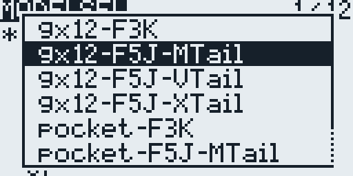

To create a model, open the model list, select an empty slot, press `ENTER`,
choose `Restore model`, and pick a `pocket-*` or `gx12-*` template; EdgeTX on
black-and-white radios lists `/BACKUP` there. Keep the motor disconnected while
you check the screens, the channels, the switches, and the failsafe, and remove
the propeller before you power the motor to check its direction.

## Credits

The SoarOTX soaring scripts are by Jesper Frickmann. This is a personal
adaptation for EdgeTX, the Pocket, and the GX12 by Vitaliy Ryumshyn, not an
official SoarOTX release. The package also includes OpenTX and EdgeTX SD-card
components from their respective authors. The version for colour-screen EdgeTX
radios is [soar-edgetx](https://github.com/vitas/soar-edgetx).

## License

Most included scripts carry GPLv2 notices from SoarOTX, OpenTX, or EdgeTX. See
`LICENSE` and `NOTICE`; individual file headers remain authoritative.
