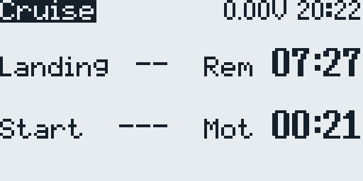
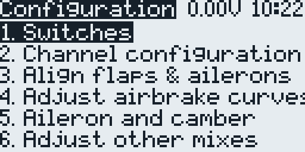
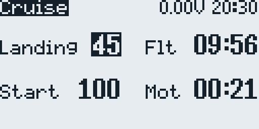
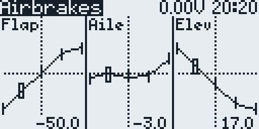
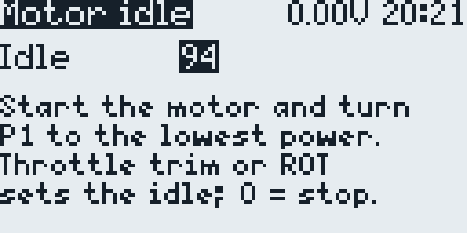

# Soar EdgeTX BW

EdgeTX black-and-white SD-card package with soaring model templates adapted
from SoarOTX.

This repository is for small BW radios such as RadioMaster Pocket, RadioMaster
GX12, and related 128x64/212x64 EdgeTX radios. It keeps the original
SoarOTX-style telemetry and setup scripts, with model and SD-card adjustments
for EdgeTX and Pocket/GX12 use.

  

**Guide (PDF):** an F5J M-tail model on the Pocket and the GX12 step by step,
from the files on the radio to the first flight, in
[English](docs/guides/SoarEdgeTX-BW-MTail-en.pdf),
[Russian](docs/guides/SoarEdgeTX-BW-MTail-ru.pdf), and
[Bulgarian](docs/guides/SoarEdgeTX-BW-MTail-bg.pdf).

## What Is Included

- `dist/SDCARD/` - the SD-card tree of the author's radio. It contains the
  model templates, the F3K/F5J telemetry and setup scripts, and the custom
  soaring voice prompts; copy only those parts (see [Install](#install)).
- `dist/SDCARD/TEMPLATES/3.SoarEdgeTx/` - the model templates: F3K and F5J
  X-/M-/V-tail for the RadioMaster Pocket (`pocket-*`) and for the RadioMaster
  GX12 (`gx12-*`).
- `dist/SDCARD/SCRIPTS/TELEMETRY/` - the F3K/F5J/JFXJ/JFXK telemetry and setup
  scripts for BW screens.
- `dist/SDCARD/SOUNDS/en/` - the custom soaring voice prompts used by the
  templates.

The templates use score/timer plus setup/configuration screens instead of the
SoarOTX graph screen. Apply a template on the radio and configure it for the
aircraft before flight; see [Install](#install) for the setup steps.

## Pocket Templates

The SD-card package includes four RadioMaster Pocket templates:

- `dist/SDCARD/TEMPLATES/3.SoarEdgeTx/pocket-F3K.yml`
- `dist/SDCARD/TEMPLATES/3.SoarEdgeTx/pocket-F5J-XTail.yml`
- `dist/SDCARD/TEMPLATES/3.SoarEdgeTx/pocket-F5J-MTail.yml`
- `dist/SDCARD/TEMPLATES/3.SoarEdgeTx/pocket-F5J-VTail.yml`

The F3K template implements the SoarOTX F3K task set. The F5J templates share a
common F5J setup and use these channel assignments:

| Channel | X-tail | M-tail | V-tail |
| --- | --- | --- | --- |
| CH1 | Left aileron | Left aileron | Left aileron |
| CH2 | Right aileron | Right aileron | Right aileron |
| CH3 | Motor | Motor | Motor |
| CH4 | Left flap | Left flap | Left flap |
| CH5 | Right flap | Right flap | Right flap |
| CH6 | Rudder | Rudder | Unused |
| CH7 | Elevator | Left elevator | Left V-tail |
| CH8 | Unused | Right elevator | Right V-tail |

### M-tail Elevator Mixes

`M-tail` drives the two elevator servos from `CH7` and `CH8` and adds two
optional differential elevator mixes:

| Mix | Enable switch | Default | Effect |
| --- | --- | --- | --- |
| `AilEle` (aileron to elevator) | `L46` | Off | `+20` on `CH7`, `-20` on `CH8`, differential `-50` |
| `RudEle` (rudder to elevator) | `L48` | Off | `+20` on `CH7`, `-20` on `CH8` |

The opposite `CH8` sign keeps the two mirrored elevator servos moving together.
Both mixes are active in `Cruise`, `Speed`, and `Float`, and disabled in
`Adjust`, `Motor`, and `KAPOW`. `L46` and `L48` are defined on every F5J variant
and are off by default: their first switch is `!ON`, because EdgeTX treats an
empty switch (`NONE`) as always on. To use a mix, set that switch in the radio's
Logical Switches menu to a physical switch, or to `ON` to keep the mix on. The
`AilEle` differential of `-50` halves the travel of the elevator half that moves
down; it is fixed because the Pocket and the GX12 have only nine global
variables. The mixes are only present on `M-tail`; `X-tail` has a single
elevator output and `V-tail` uses its two surfaces for the V-tail mix.

### V-tail Mixing

The V-tail servos mix two virtual channels. `CH18` `Rudd` carries the rudder
stick plus the `AilRud` aileron-to-rudder mix (`GV3`), as `CH6` does on the
other variants. `CH19` `Elev` carries the elevator stick plus the elevator
compensation from `CH22`. `CH7` gets 50% of `CH18` minus 50% of `CH19`, and
`CH8` gets 50% of both, so rudder moves the two servos the same way and elevator
moves them in opposite directions. Each servo gets half of the rudder and
elevator travel, so full rudder with full elevator stays within 100%; set the
throws with the output endpoints.

### Airbrake Elevator Curve

The F5J templates shape the airbrake elevator compensation with curve `CV14`
`BrE`. The compensation in `CH22` is `BkE` (`GV5`) times `1 + BrE / 100`: at
`-100` there is none, at `0` it equals `BkE`, and at `100` it is `2 x BkE`. The
default `67, 17, -33, -83, -100` gives the same compensation as earlier
templates with their default flap curve, which the compensation followed.

The configuration page `3. Adjust airbrake curves` shows the flap, aileron, and
elevator curves. The throttle stick selects a point; the throttle trim adjusts
the flap curve, the aileron trim the aileron curve, and the elevator trim the
elevator curve. The last point (brakes off) of `BrE` stays at `-100`, so in
normal flight the elevator stays where the trim puts it. The elevator does not
move with the curve on this page, because `BkE` in the `Adjust` flight mode
stores the help setting. Models from earlier templates have no `BrE`: the page
shows `N/A` for the elevator, and the elevator trim still adjusts the aileron
curve.

### Camber and Reflex

In flight, the throttle trim `T3` (input `CbP`) sets the camber. The input has
a `-100` differential, so only `T3` below center reaches the mixes: it adds
camber and never reflex. Cruise and Float keep their own `T3`:

| Flight mode | Flaps and ailerons |
| --- | --- |
| Speed | No camber, and `T3` is off: the surfaces sit at the neutral, the last points of the `BrF` and `BrA` brake curves. |
| Cruise | `T3` only: below center adds camber, center and above add none. The templates start at center. |
| Float | The throttle stick plus `T3`. The `CambrX` mix in `CH25` adds no camber with the stick down and 32 with the stick up, in proportion in between, whether crow is on or off. |

In camber the ailerons follow the flaps by `CbA` (`GV7`), 153 % in the
templates; the configuration page `4. Aileron and camber` sets it with the
elevator trim. The Pocket and the GX12 have only nine global variables, so the
thermal camber amount is fixed in `CambrX`: weight `32` and offset `-32`.
Change both to the same number, the offset negative, so that the stick at the
bottom still adds no camber.

Reflex comes from the brake curves, because Speed has no camber. On
`3. Adjust airbrake curves`, put the throttle stick down to select the last
point, then raise the flaps with the throttle trim and the ailerons with the
aileron trim by the reflex you want. Cruise and Float count their camber from
the same neutral, so then bring Cruise back down with `T3`, and lower `T3` in
Float if needed.

### Motor Idle

The configuration page `7. Motor idle` sets the first point of curve `CV13`
`Pot`, which lifts the motor command at the low end of the `P1` motor power
range in the `Motor` flight mode. The template value is `99`; the range is `0`
to `100`, and at `0` the motor stops with `P1` at the lowest power. The page
scales the middle point with the idle, so the `P1` range keeps its shape.

This page needs the motor connected. It shows a propeller warning first; hold
the model and keep clear before you press `ENTER`. The page does not start the
motor:

1. Open the page and press `ENTER` on the warning.
2. Start the motor as usual and turn `P1` to the lowest power.
3. Press the throttle trim (`T3`) up or down, or turn the wheel. Each click
   changes the idle by 1, and the motor follows at once.
4. Stop the motor and press `EXIT`. The idle stays in the model.

While the page is open, it holds `GV8` at `100`. The template's `L49` and `SF39`
then count throttle trim clicks in `GV8` instead of moving the trim, so thermal
camber does not change. `EXIT` releases the throttle trim. On models from
earlier templates, which have no `L49` and `SF39`, the throttle trim works as
usual; use the wheel (`+`/`-` on radios without one) instead.

### Motor Power Direction

`I4:Mot` takes `P1` inverted (weight `-100`) through curve CV9 `Mot`, and the
`RwMot` line of `CH20` passes it on to the motor channel `CH3`. In the `Motor`
flight mode, the `+100` end of `P1` gives the lowest power, held over the last
5% of the travel, and the `-100` end gives full power.

For the lowest power at the other end, open the model inputs, select `I4:Mot`,
and change the curve of its `On` line from `Mot` to `!Mot`, curve CV9 inverted.
Keep the weight `-100` and leave the `Off` line as it is: `P1` then works as
before, only from the other end. Do not set the `On` weight to `+100` instead:
full power then comes as a step in the last 5% of the travel, and the lowest
power is only at the very end. No logical switch or script reads `P1`, and the
motor idle page changes only curve CV13 `Pot`, so nothing else needs changing.
Check the result in the `3. Moto` row of `1. Channel configuration` with the
motor disconnected.

### Brake and Camber Direction

`I5:Brk` takes the throttle stick inverted (weight `-100`) and drives both the
airbrakes and the Float thermal camber. With the stick down the airbrakes are
retracted and Float adds no thermal camber; with the stick up both are full.
Curve CV11 `DB` keeps the airbrakes fully retracted in the bottom 5% of the
stick travel.

To turn both around, open the model inputs, select `I5:Brk`, and set the
weight of its `Brake` line to `+100`. The stick down then gives full airbrakes
and full thermal camber, the stick up gives neither, and the 5% zone with the
airbrakes fully retracted moves to the top of the stick travel. Nothing else
depends on this direction: the airbrake curves, the brake elevator
compensation, and the `BrkOff` line that keeps the airbrakes retracted with
crow off (`L36`) all work from the brake channel `CH21`, and no logical switch
or script reads `Thr` or `I5:Brk`.

The templates keep the throttle warning on, with the throttle stick as its
source, so at power-on it asks for the stick down. After this change that is
full airbrakes. To switch on with the airbrakes retracted, open the model setup
and, under `Preflight Checks`, tick `Cust-Pos` (the custom position of
`T-Warning`) and set its value to `100`.

To turn only the thermal camber around, open the `CH25` mixes and change the
curve of the `CambrX` line from `LSl` to `!LSl`, curve CV12 inverted.

Leave `I8:Adj` as it is. The wing alignment and airbrake setup pages select
curve points with it, so they keep the stick directions described in the
guides. To make them follow the new direction too, set the weight of its
`Adjust` line to `+100` as well: curve CV8 `Adj` is symmetric, so the point
selection mirrors exactly.

Leave the throttle reverse option in the model setup off. It turns the whole
throttle stick around at once, the setup pages included, and the stick
directions in the guides no longer match.

### Camber Slider

A slider or pot can set the camber in two ways; on the GX12, `S1`, `S2`, and
`P2` are free. If the control is missing from the source list, enable it in the
radio's hardware settings. Check the result with the motor disconnected.

In addition to `T3`, use `I7:Cmb`. Its `Camber` line has the source `MAX`,
which adds no camber through the `Slider` line of `CH25` (curve CV11 `DB`,
weight `10`, offset `-10`). With a slider as the source, `CH25` gets `0` in the
last 5% of the travel at the `+100` end and `-20` at the `-100` end; for
comparison, full Float thermal camber is `-32`. `T3` keeps working on top of
the slider. The `Slider` line is active in every flight mode and is not reduced
while the motor runs, so untick `FM1` to `FM4` (`Adjust`, `Motor`, `KAPOW`,
`Speed`) in that line and keep `Cruise` and `Float`. Untick them in the `CH25`
line, not in the `I7:Cmb` input: a switched-off input line does not bring this
camber to zero.

Instead of `T3`, change the source of the `CambPs` line of `I6:CbP` from `T3`
to the slider. It then works like `T3`: below center it adds camber, center and
above add none. One slider position serves all flight modes, so `Cruise` and
`Float` no longer keep their own camber, and the slider would also add camber
in `Adjust`, `KAPOW`, and `Speed`. Open the first `CH23` mix line, the one with
the source `I6:CbP`, and untick `FM1`, `FM3`, and `FM4` (`Adjust`, `KAPOW`,
`Speed`) in it. The `MotCbr` line still takes this camber away as the motor
power rises. `T3` no longer moves the camber in flight, and the setup pages
still use its buttons.

### Pocket Switch Assignments

The Pocket templates use the following primary controls. EdgeTX position names
are included because they are more precise than physical up/down descriptions.

| Switch | F3K | F5J X-/M-/V-tail |
| --- | --- | --- |
| SA | Altitude-call control | Motor arm (`SA2`, latched by `L23`) |
| SB | Altitude-announcement control | Flight-time announcement (`SB2` through `L12`) |
| SC | Flight mode: Speed (`SC0`), Cruise (center), Float (`SC2`) | Flight mode: Speed (`SC0`), Cruise (center), Float (`SC2`) |
| SD | Brake/landing control (`SD2`); crow-off on `SD0` | Proportional crow enabled on `SD2` (`L36` off); score entry and landing announcement (`SD2` through `L7`); crow off and landing-off announcement (`SD0` through `L36`) |
| SE | Launch (`SE2` through `L7`) | Motor start/release (`SE2` through `L9`) |

For F5J, arm with SA before using SE. After the motor run and motor-off count,
move SD down to enable throttle-controlled proportional crow, finish the flight,
and open landing-score entry. Move SD up to force crow off. Hold SB down for
repeating flight-time announcements. Keep the motor disconnected while checking
these assignments on a newly created model.

The templates are sanitized: they contain no personal binding, registration,
or discovered telemetry data. Output calibration and flight trims are neutral,
and the physical aileron/flap alignment curves start with a linear response.
You must configure each template for the aircraft before flight.

To install and configure a template safely:

1. Back up the radio and current model.
2. Remove the propeller or disconnect the motor before applying the template.
   Keep propulsion isolated throughout receiver setup and output configuration.
3. Restore the template from `/BACKUP/` on the radio (see [Install](#install)).
4. Bind and configure the receiver, then discover telemetry sensors.
5. Configure endpoints, centers, reversals, and setup curves for the aircraft.
6. With the motor disconnected where possible, verify outputs, scripts, switch
   assignments, and failsafe behavior.
7. To verify motor direction, remove the propeller, reconnect the motor if
   needed, and power it only briefly.

## RadioMaster GX12

The same four templates are also provided for the RadioMaster GX12, which is
supported by EdgeTX from v2.11 and uses the same 128x64 black-and-white
interface as the Pocket, with a switch layout for its controls:

- `dist/SDCARD/TEMPLATES/3.SoarEdgeTx/gx12-F3K.yml`
- `dist/SDCARD/TEMPLATES/3.SoarEdgeTx/gx12-F5J-XTail.yml`
- `dist/SDCARD/TEMPLATES/3.SoarEdgeTx/gx12-F5J-MTail.yml`
- `dist/SDCARD/TEMPLATES/3.SoarEdgeTx/gx12-F5J-VTail.yml`

The `gx12-*` files are identical to the matching `pocket-*` templates apart from
the model name and the switch definitions below, so the channel assignments,
setup pages, and mixes described above apply unchanged.

| Item | GX12 |
| --- | --- |
| EdgeTX target | `gx12` (`PCB=X7`, `PCBREV=GX12`) |
| Display | 128x64 monochrome OLED |
| Processor | STM32F407 |
| Global variables | 9 (`GV1`-`GV9`), same as the Pocket |
| Buttons | `SA`, `SD`, `SG`, `SH` (momentary) |
| Switches | `SB`, `SC`, `SE`, `SF` 3-position |
| Other controls | `S1`/`S2` sliders, `P1`/`P2` dials, six buttons `SW1`-`SW6` |
| Storage | 512 MB internal memory, mounted as the SD-card root over USB |

The GX12's `SA` and `SD` are buttons, so the Pocket layout would arm the motor
only while `SA` is held. In the GX12 templates a press on `SA` arms and the next
press disarms, and `SD` applies the brakes while it is held:

| Switch | F3K | F5J X-/M-/V-tail |
| --- | --- | --- |
| SA button | Free | Motor arm toggle (`SA2` held for at least 0.3 s by `L41`/`L42`, flips `L5`, latched by `L23`); a motor stop disarms (`L31` through `L33`) |
| SB | Altitude-announcement control | Free |
| SC | Free | Flight-time announcement (`SC2` through `L12`) |
| SD button | Brake/landing control while held (`SD2` through `L8`); crow off on release (`SD0` through `L35`) | Proportional crow while held (`SD2`, `L36` off); score entry and landing announcement (`SD2` through `L7`); crow off and landing-off announcement on release (`SD0` through `L36`) |
| SE | Altitude-call control (`SE2` through `L1`) | Free |
| SF | Flight mode: Speed (`SF0`), Cruise (center), Float (`SF2`) | Flight mode: Speed (`SF0`), Cruise (center), Float (`SF2`) |
| SG button | Launch (through `L7`) | Motor start/release (through `L9`) |

For F5J, press `SA` to arm, then press `SG` where the Pocket flicks `SE`. Each
`SA` press flips the arming, and a press while the motor runs stops it. When the
motor stops, the arming drops by itself, so a restart needs a new `SA` press.
The radio skips `SA` presses less than half a second apart; the siren and
"MOTOR ARMED" confirm the arming. `P1` still sets the motor power. The `SH`
button, the sliders, `P2`, and `SW1`-`SW6` are free in both templates. The GX12
has no extended global variables, so the fixed `AilEle`/`RudEle` weights
(`+20`/`-20`) and the `AilEle` differential are required there as well.

The GX12 has no SD card: over USB its internal storage appears as the SD card.
Copy the same package parts to it (see [Install](#install)), then restore a
`gx12-*` template on the radio.

## Install

`dist/SDCARD/` mirrors the SD card of the author's radio: besides the package
it holds models (`MODELS/`), radio settings (`RADIO/`), firmware, and other
files. Copy only the package parts below, or they replace your own models and
settings. The [guide](docs/guides/SoarEdgeTX-BW-MTail-en.pdf) walks through
these steps for an F5J M-tail model.

1. Back up the radio SD card and models first. On the GX12, back up its internal
   storage.
2. Install the standard EdgeTX SD-card sound pack for your firmware version.
3. Copy these parts of `dist/SDCARD/` to the radio SD card:

   | From `dist/SDCARD/` | To |
   | --- | --- |
   | `SCRIPTS/TELEMETRY/` (the whole folder) | `/SCRIPTS/TELEMETRY/` |
   | `SCRIPTS/FUNCTIONS/JFutil.lua` | `/SCRIPTS/FUNCTIONS/` |
   | `TEMPLATES/3.SoarEdgeTx/*.yml` | `/BACKUP/` |
   | `SOUNDS/en/*.wav` | `/SOUNDS/en/` |

4. Create the model from a template: open the model list, select an empty slot,
   press `ENTER`, choose `Restore model`, and pick a `pocket-*` or `gx12-*`
   template. EdgeTX on black-and-white radios has no template list for new
   models; `Restore model` lists the files in `/BACKUP/`. You can also copy the
   template YAML into `MODELS/` if you know your radio layout.
5. On the radio, keep propulsion isolated while verifying script screens,
   channel order, switch assignments, and failsafe. Remove the propeller before
   briefly powering the motor to verify its direction.

When updating an existing SD card, delete these old generated helper files if
they are present before copying the new package:

- `/SCRIPTS/TELEMETRY/128x64/ARMED.luac`
- `/SCRIPTS/TELEMETRY/128x64/JFutil.luac`
- `/SCRIPTS/TELEMETRY/128x64/MENU.luac`

They can prevent F3K/F5J timer and setup screens from opening on Pocket/128x64
EdgeTX radios.

Also delete `/SCRIPTS/TELEMETRY/JFXJcf.luac` and
`/SCRIPTS/TELEMETRY/JF5Jsk.luac` if they are present. Earlier packages included
them, compiled from older versions of the F5J configuration menu and timer
scripts, and EdgeTX runs a `.luac` file instead of its `.lua` unless the `.lua`
is newer, so the old menu would hide the `7. Motor idle` page. The radio
compiles new copies from the `.lua` files.

## Notes

- This is a personal EdgeTX/Pocket adaptation of SoarOTX, not an official
  SoarOTX release.
- The full standard EdgeTX sound pack is intentionally not tracked here. Only
  the custom model prompts are committed.
- The package still includes some `.luac` files because precompiled scripts can
  reduce load time and memory pressure on small BW radios. Matching Lua source
  files are included where available.
- F3K task notes, including 2026 FAI task coverage and the custom `A2` task,
  are in `dist/SDCARD/SCRIPTS/TELEMETRY/F3K_readme.txt`.
- Keep the model-specific calibrations, receiver protocol, failsafe, and switch
  assignments under review before flying.

## Development

Host verification requires `make`, `bash`, `git`, `file`, `rg`, `lua`, `luac`,
and `ruby` with its standard-library Psych YAML parser.

Run `make verify` to check shell, Ruby, and Lua syntax, YAML structure, Lua
loading, F3K tasks, and model-template contracts.

## Credits

Original SoarOTX soaring scripts were created by Jesper Frickmann. This package
also includes OpenTX/EdgeTX SD-card components from their respective authors.

Pocket and EdgeTX BW adjustments by Vitaliy Ryumshyn.

## License

Most included scripts carry GPLv2 notices from SoarOTX, OpenTX, or EdgeTX. See
`LICENSE` and `NOTICE`; individual file headers remain authoritative.
