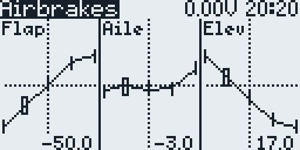
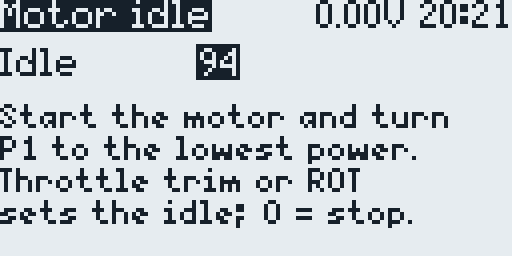
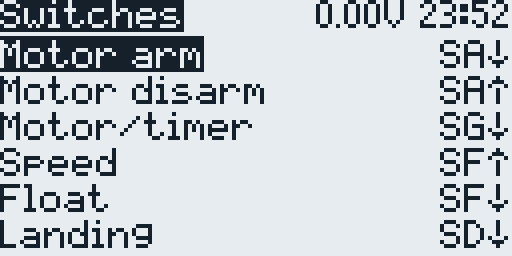
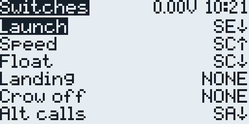

# Soar EdgeTX BW Reference

The details behind the [README](../README.md): what the package holds, the
channels, mixes, and switches of the templates, and how to turn a control or a
direction around. The guides take a model step by step from the files on the
radio to the first flight: [F3K](guides/SoarEdgeTX-BW-F3K-en.pdf) in English,
and the F5J M-tail in [English](guides/SoarEdgeTX-BW-MTail-en.pdf),
[Russian](guides/SoarEdgeTX-BW-MTail-ru.pdf), and
[Bulgarian](guides/SoarEdgeTX-BW-MTail-bg.pdf).

## What Is Included

- `dist/SDCARD/` - the SD-card tree of the author's radio. It contains the
  model templates, the F3K/F5J telemetry and setup scripts, and the custom
  soaring voice prompts; copy only those parts (see [Install](../README.md#install)).
- `dist/SDCARD/TEMPLATES/3.SoarEdgeTx/` - the model templates: F3K and F5J
  X-/M-/V-tail for the RadioMaster Pocket (`pocket-*`) and for the RadioMaster
  GX12 (`gx12-*`).
- `dist/SDCARD/SCRIPTS/TELEMETRY/` - the F3K/F5J/JFXJ/JFXK telemetry and setup
  scripts for BW screens.
- `dist/SDCARD/SOUNDS/en/` - the custom soaring voice prompts used by the
  templates.

The templates use score/timer plus setup/configuration screens instead of the
SoarOTX graph screen. Apply a template on the radio and configure it for the
aircraft before flight; see [Install](../README.md#install) for the setup steps.

## Pocket Templates

The SD-card package includes four RadioMaster Pocket templates:

- `dist/SDCARD/TEMPLATES/3.SoarEdgeTx/pocket-F3K.yml`
- `dist/SDCARD/TEMPLATES/3.SoarEdgeTx/pocket-F5J-XTail.yml`
- `dist/SDCARD/TEMPLATES/3.SoarEdgeTx/pocket-F5J-MTail.yml`
- `dist/SDCARD/TEMPLATES/3.SoarEdgeTx/pocket-F5J-VTail.yml`

The F3K template drives the flaperons from `CH1` (`Ai-L`) and `CH2` (`Ai-R`), the
elevator from `CH3`, and the rudder from `CH4`; `CH25` to `CH32` are internal
mixes. The F5J templates share a common F5J setup and use these channel
assignments:

| Channel | X-tail | M-tail | V-tail |
| --- | --- | --- | --- |
| CH1 | Left aileron | Left aileron | Left aileron |
| CH2 | Right aileron | Right aileron | Right aileron |
| CH3 | Motor | Motor | Motor |
| CH4 | Left flap | Left flap | Left flap |
| CH5 | Right flap | Right flap | Right flap |
| CH6 | Rudder | Rudder | Unused |
| CH7 | Elevator | Left elevator | Left V-tail |
| CH8 | Unused | Right elevator | Right V-tail |

In every template, F3K included, the aileron line of `CH1` and `CH2` leaves the
trim out. The line after it, `AilTrm`, adds the aileron trim `T4` after the
differential, through the curve `Trm`, which gives the 25% that full trim adds
to a line, and the aileron weight `GV1`, so both ailerons trim by the same
amount.

### M-tail Elevator Mixes

`M-tail` drives the two elevator servos from `CH7` and `CH8` and adds two
optional differential elevator mixes:

| Mix | Enable switch | Default | Effect |
| --- | --- | --- | --- |
| `AilEle` (aileron to elevator) | `L46` | Off | `+20` on `CH7`, `-20` on `CH8`, differential `-50` |
| `RudEle` (rudder to elevator) | `L48` | Off | `+20` on `CH7`, `-20` on `CH8` |

The opposite `CH8` sign keeps the two mirrored elevator servos moving together.
Both mixes are active in `Cruise`, `Landing`, `Speed`, and `Float`, and disabled
in `Adjust` and `Motor`. `L46` and `L48` are defined on every F5J variant
and are off by default: their first switch is `!ON`, because EdgeTX treats an
empty switch (`NONE`) as always on. To use a mix, choose its switch, or `ON` to
keep the mix on, in the `Ail->Ele` or `Rud->Ele` row of the
[F5J Switches Page](#f5j-switches-page), or set that first switch in the
radio's Logical Switches menu. The `AilEle` differential of `-50` halves the
travel of the elevator half that moves
down; it is fixed because the Pocket and the GX12 have only nine global
variables. The mixes are only present on `M-tail`; `X-tail` has a single
elevator output and `V-tail` uses its two surfaces for the V-tail mix.

### V-tail Mixing

The V-tail servos mix two virtual channels. `CH18` `Rudd` carries the rudder
stick plus the `AilRud` aileron-to-rudder mix (`GV3`), as `CH6` does on the
other variants. `CH19` `Elev` carries the elevator stick plus the elevator
compensation from `CH22`. `CH7` gets 50% of `CH18` minus 50% of `CH19`, and
`CH8` gets 50% of both, so rudder moves the two servos the same way and elevator
moves them in opposite directions. Each servo gets half of the rudder and
elevator travel, so full rudder with full elevator stays within 100%; set the
throws with the output endpoints.

### Airbrake Elevator Curve

The F5J templates shape the airbrake elevator compensation with curve `CV14`
`BrE`. The compensation in `CH22` is `BkE` (`GV5`) times `1 + BrE / 100`: at
`-100` there is none, at `0` it equals `BkE`, and at `100` it is `2 x BkE`. The
default `67, 17, -33, -83, -100` gives the same compensation as earlier
templates with their default flap curve, which the compensation followed.

The configuration page `4. Adjust airbrake curves` shows the flap, aileron, and
elevator curves. The throttle stick selects a point; the throttle trim adjusts
the flap curve, the aileron trim the aileron curve, and the elevator trim the
elevator curve. The last point (brakes off) of `BrE` stays at `-100`, so in
normal flight the elevator stays where the trim puts it. The elevator does not
move with the curve on this page, because `BkE` in the `Adjust` flight mode
stores the help setting. Models from earlier templates have no `BrE`: the page
shows `N/A` for the elevator, and the elevator trim still adjusts the aileron
curve.

### Camber and Reflex

In flight, the throttle trim `T3` (input `CbP`) sets the camber. The input has
a `-100` differential, so only `T3` below center reaches the mixes: it adds
camber and never reflex. Cruise and Float keep their own `T3`:

| Flight mode | Flaps and ailerons |
| --- | --- |
| Speed | No camber, and `T3` is off: the surfaces sit at the neutral, the last points of the `BrF` and `BrA` brake curves. |
| Cruise | `T3` only: below center adds camber, center and above add none. The templates start at center. |
| Float | The throttle stick plus `T3`. The `CambrX` mix in `CH25` adds no camber with the stick down and 32 with the stick up, in proportion in between, whether crow is on or off. |

In camber the ailerons follow the flaps by `CbA` (`GV7`), 153 % in the
templates; the configuration page `5. Aileron and camber` sets it with the
elevator trim. The Pocket and the GX12 have only nine global variables, so the
thermal camber amount is fixed in `CambrX`: weight `32` and offset `-32`.
Change both to the same number, the offset negative, so that the stick at the
bottom still adds no camber.

Reflex comes from the brake curves, because Speed has no camber. On
`4. Adjust airbrake curves`, put the throttle stick down to select the last
point, then raise the flaps with the throttle trim and the ailerons with the
aileron trim by the reflex you want. Cruise and Float count their camber from
the same neutral, so then bring Cruise back down with `T3`, and lower `T3` in
Float if needed.

### Motor Idle

The configuration page `8. Motor idle` sets the first point of curve `CV13`
`Pot`, which lifts the motor command at the low end of the `P1` motor power
range in the `Motor` flight mode. The template value is `99`; the range is `0`
to `100`, and at `0` the motor stops with `P1` at the lowest power. The page
scales the middle point with the idle, so the `P1` range keeps its shape.

This page needs the motor connected. It shows a propeller warning first; hold
the model and keep clear before you press `ENTER`. The page does not start the
motor:

1. Open the page and press `ENTER` on the warning.
2. Start the motor as usual and turn `P1` to the lowest power.
3. Press the throttle trim (`T3`) up or down, or turn the wheel. Each click
   changes the idle by 1, and the motor follows at once.
4. Stop the motor and press `EXIT`. The idle stays in the model.

While the page is open, it holds `GV8` at `100`. The template's `L49` and `SF39`
then count throttle trim clicks in `GV8` instead of moving the trim, so thermal
camber does not change. `EXIT` releases the throttle trim. On models from
earlier templates, which have no `L49` and `SF39`, the throttle trim works as
usual; use the wheel (`+`/`-` on radios without one) instead.

### Motor Power Direction

`I4:Mot` takes `P1` inverted (weight `-100`) through curve CV9 `Mot`, and the
`RwMot` line of `CH20` passes it on to the motor channel `CH3`. In the `Motor`
flight mode, the `+100` end of `P1` gives the lowest power, held over the last
5% of the travel, and the `-100` end gives full power.

For the lowest power at the other end, open the model inputs, select `I4:Mot`,
and change the curve of its `On` line from `Mot` to `!Mot`, curve CV9 inverted.
Keep the weight `-100` and leave the `Off` line as it is: `P1` then works as
before, only from the other end. Do not set the `On` weight to `+100` instead:
full power then comes as a step in the last 5% of the travel, and the lowest
power is only at the very end. No logical switch or script reads `P1`, and the
motor idle page changes only curve CV13 `Pot`, so nothing else needs changing.
Check the result in the `3. Moto` row of `2. Channel configuration` with the
motor disconnected.

### Brake and Camber Direction

`I5:Brk` takes the throttle stick inverted (weight `-100`) and drives both the
airbrakes and the Float thermal camber. With the stick down the airbrakes are
retracted and Float adds no thermal camber; with the stick up both are full.
Curve CV11 `DB` keeps the airbrakes fully retracted in the bottom 5% of the
stick travel.

To turn both around, open the model inputs, select `I5:Brk`, and set the
weight of its `Brake` line to `+100`. The stick down then gives full airbrakes
and full thermal camber, the stick up gives neither, and the 5% zone with the
airbrakes fully retracted moves to the top of the stick travel. Nothing else
needs changing: the airbrake curves, the brake elevator compensation, and the
`BrkOff` line that keeps the airbrakes retracted (switch `L51`, see
[F5J Switches Page](#f5j-switches-page)) all work from the brake channel
`CH21`. The only logical switch that reads `I5:Brk` is `L35`, the
brakes-retracted zone of the throttle crow, and it follows the new direction by
itself. No script reads `Thr` or `I5:Brk`.

The templates keep the throttle warning on, with the throttle stick as its
source, so at power-on it asks for the stick down. After this change that is
full airbrakes. To switch on with the airbrakes retracted, open the model setup
and, under `Preflight Checks`, tick `Cust-Pos` (the custom position of
`T-Warning`) and set its value to `100`.

To turn only the thermal camber around, open the `CH25` mixes and change the
curve of the `CambrX` line from `LSl` to `!LSl`, curve CV12 inverted.

Leave `I8:Adj` as it is. The wing alignment and airbrake setup pages select
curve points with it, so they keep the stick directions described in the
guides. To make them follow the new direction too, set the weight of its
`Adjust` line to `+100` as well: curve CV8 `Adj` is symmetric, so the point
selection mirrors exactly.

Leave the throttle reverse option in the model setup off. It turns the whole
throttle stick around at once, the setup pages included, and the stick
directions in the guides no longer match.

### Camber Slider

A slider or pot can set the camber in two ways; on the GX12, `S1`, `S2`, and
`P2` are free. If the control is missing from the source list, enable it in the
radio's hardware settings. Check the result with the motor disconnected.

In addition to `T3`, use `I7:Cmb`. Its `Camber` line has the source `MAX`,
which adds no camber through the `Slider` line of `CH25` (curve CV11 `DB`,
weight `10`, offset `-10`). With a slider as the source, `CH25` gets `0` in the
last 5% of the travel at the `+100` end and `-20` at the `-100` end; for
comparison, full Float thermal camber is `-32`. `T3` keeps working on top of
the slider. The `Slider` line is active in every flight mode and is not reduced
while the motor runs, so untick `FM1` to `FM4` (`Adjust`, `Motor`, `Landing`,
`Speed`) in that line and keep `Cruise` and `Float`. Untick them in the `CH25`
line, not in the `I7:Cmb` input: a switched-off input line does not bring this
camber to zero.

Instead of `T3`, change the source of the `CambPs` line of `I6:CbP` from `T3`
to the slider. It then works like `T3`: below center it adds camber, center and
above add none. One slider position serves all flight modes, so `Cruise` and
`Float` no longer keep their own camber, and the slider would also add camber
in `Adjust`, `Landing`, and `Speed`. Open the first `CH23` mix line, the one
with the source `I6:CbP`, and untick `FM1`, `FM3`, and `FM4` (`Adjust`,
`Landing`, `Speed`) in it. The `MotCbr` line still takes this camber away as
the motor power rises. `T3` no longer moves the camber in flight, and the setup
pages still use its buttons.

The Float thermal camber of the throttle stick comes from the `CambrX` line of
`CH25`: source `I5:Brk`, weight `32`, offset `-32`, curve CV12 `LSl`, active
only in `FM5` (`Float`). To move it to a pot or slider, change the source of
that line to the control and keep the weight, offset, and curve. The `+100` end
of the control then gives no camber and the `-100` end the full `-32`; `!LSl`
swaps the ends. The throttle stick then moves only the airbrakes. On the GX12,
`P2`, `S1`, or `S2` can do this. The Pocket has no free pot or slider (`P1`
sets the motor power); there, untick `FM5` in the `CambrX` line to take the
camber off the stick, and the throttle trim still adds camber in `Float`. Do
one of the two when `Crow off` is `NONE` on the
[F5J Switches Page](#f5j-switches-page): the stick then moves the airbrakes all
the time, and in `Float` it would add the camber with them.

### Pocket Switch Assignments

The Pocket templates use the following primary controls. EdgeTX position names
are included because they are more precise than physical up/down descriptions.

| Switch | F3K | F5J X-/M-/V-tail |
| --- | --- | --- |
| SA | Launch height callout (`SA2` through `L1`) | Motor arm on `SA2` (through `L41`), disarm on `SA0` (through `L42`); a motor stop also disarms (`L31` through `L33`) |
| SB | Altitude every 10 seconds while `L1` is on (`SB2` through `L6`) | Flight-time announcement (`SB2` through `L12`) |
| SC | Flight mode: Speed (`SC0`), Cruise (center), Float (`SC2`) | Flight mode: Speed (`SC0`), Cruise (center), Float (`SC2`) |
| SD | Free: the throttle stick moves the brakes and switches the `Landing` flight mode | Proportional crow enabled on `SD2` (`L36` off); score entry and landing announcement (`SD2` through `L7`); crow off and landing-off announcement (`SD0` through `L36`) |
| SE | Launch (`SE2` through `L7`) | Motor start/release (`SE2` through `L9`) |

For F5J, arm with SA before using SE. The motor stop disarms even with SA still
down, so a restart needs SA up and down again. After the motor run and motor-off
count, move SD down to enable throttle-controlled proportional crow, finish the
flight, and open landing-score entry. Move SD up to force crow off. Hold SB down
for repeating flight-time announcements. Keep the motor disconnected while
checking these assignments on a newly created model. The F5J functions can move
to other switches on the [F5J Switches Page](#f5j-switches-page), and the F3K
functions on the [F3K Switches Page](#f3k-switches-page).

The templates are sanitized: they contain no personal binding, registration,
or discovered telemetry data. Output calibration and flight trims are neutral,
and the physical aileron/flap alignment curves start with a linear response.
You must configure each template for the aircraft before flight.

To install and configure a template safely:

1. Back up the radio and current model.
2. Remove the propeller or disconnect the motor before applying the template.
   Keep propulsion isolated throughout receiver setup and output configuration.
3. Restore the template from `/BACKUP/` on the radio (see [Install](../README.md#install)).
4. Bind and configure the receiver, then discover telemetry sensors.
5. Configure endpoints, centers, reversals, and setup curves for the aircraft.
6. With the motor disconnected where possible, verify outputs, scripts, switch
   assignments, and failsafe behavior.
7. To verify motor direction, remove the propeller, reconnect the motor if
   needed, and power it only briefly.

## RadioMaster GX12

The same four templates are also provided for the RadioMaster GX12, which is
supported by EdgeTX from v2.11 and uses the same 128x64 black-and-white
interface as the Pocket, with a switch layout for its controls:

- `dist/SDCARD/TEMPLATES/3.SoarEdgeTx/gx12-F3K.yml`
- `dist/SDCARD/TEMPLATES/3.SoarEdgeTx/gx12-F5J-XTail.yml`
- `dist/SDCARD/TEMPLATES/3.SoarEdgeTx/gx12-F5J-MTail.yml`
- `dist/SDCARD/TEMPLATES/3.SoarEdgeTx/gx12-F5J-VTail.yml`

The `gx12-*` files are identical to the matching `pocket-*` templates apart from
the model name, the switch definitions below and, in F5J, the `SA` latch, so the
channel assignments, setup pages, and mixes described above apply unchanged.

| Item | GX12 |
| --- | --- |
| EdgeTX target | `gx12` (`PCB=X7`, `PCBREV=GX12`) |
| Display | 128x64 monochrome OLED |
| Processor | STM32F407 |
| Global variables | 9 (`GV1`-`GV9`), same as the Pocket |
| Buttons | `SA`, `SD`, `SG`, `SH` (momentary; the F5J templates latch `SA`) |
| Switches | `SB`, `SC`, `SE`, `SF` 3-position |
| Other controls | `S1`/`S2` sliders, `P1`/`P2` dials, six buttons `SW1`-`SW6` |
| Storage | 512 MB internal memory, mounted as the SD-card root over USB |

The GX12's `SA` and `SD` are buttons. The F5J templates make `SA` latch in the
model (`MDL`, `SETUP`, `Customizable Switches`: `SA` set to `2POS`, starting
released): a press locks `SA` in and lights it, and the next press releases it.
`SA` then arms and disarms as the Pocket's `SA` switch does. In F5J, the
throttle stick moves the airbrakes while `SD` is held:

| Switch | F3K | F5J X-/M-/V-tail |
| --- | --- | --- |
| SA button | Free | Motor arm when pressed in (`SA2` through `L41`), disarm when released (`SA0` through `L42`); a motor stop also disarms (`L31` through `L33`) |
| SB | Altitude every 10 seconds while `L1` is on (`SB2` through `L6`) | Free |
| SC | Free | Flight-time announcement (`SC2` through `L12`) |
| SD button | Free: the throttle stick moves the brakes and switches the `Landing` flight mode | Proportional crow while held (`SD2`, `L36` off); score entry and landing announcement (`SD2` through `L7`); crow off and landing-off announcement on release (`SD0` through `L36`) |
| SE | Launch height callout (`SE2` through `L1`) | Free |
| SF | Flight mode: Speed (`SF0`), Cruise (center), Float (`SF2`) | Flight mode: Speed (`SF0`), Cruise (center), Float (`SF2`) |
| SG button | Launch (through `L7`) | Motor start/release (through `L9`) |

For F5J, press `SA` to arm, then press `SG` where the Pocket flicks `SE`. The
next `SA` press disarms, and a press while the motor runs stops it. When the
motor stops any other way, the arming drops by itself, but `SA` stays in and
lit, so a restart takes two presses: one to release `SA` and one to arm. The
siren and "MOTOR ARMED" confirm the arming; the `SA` light only shows that the
button is in. `P1` still sets the motor power. The `SH` button, the sliders,
`P2`, and `SW1`-`SW6` are free in both templates. The GX12
has no extended global variables, so the fixed `AilEle`/`RudEle` weights
(`+20`/`-20`) and the `AilEle` differential are required there as well. The
[F5J Switches Page](#f5j-switches-page) moves the F5J functions to other
controls, the free ones included, and the [F3K Switches Page](#f3k-switches-page)
does the same for F3K.

The GX12 has no SD card: over USB its internal storage appears as the SD card.
Copy the same package parts to it (see [Install](../README.md#install)), then restore a
`gx12-*` template on the radio.

## F5J Switches Page

The F5J Configuration menu (telemetry screen 2) starts with the `1. Switches` page. Each
row sets the first switch of one logical switch, and the change is written to
the model at once. The radio shows the positions with arrows: `SA2` is `SA↓`.

| Row | Function | Logical switch | GX12 | Pocket |
| --- | --- | --- | --- | --- |
| `Motor arm` | Turns the motor arming on | `L41` | `SA2` | `SA2` |
| `Motor disarm` | Turns the motor arming off; the end of a motor run does it too | `L42` | `SA0` | `SA0` |
| `Motor/timer` | Motor start and stop; trigger of the score keeper | `L9` | `SG2` | `SE2` |
| `Speed` | Flight mode `Speed` | `L3` | `SF0` | `SC0` |
| `Float` | Flight mode `Float`; `Cruise` when neither is on | `L4` | `SF2` | `SC2` |
| `Landing` | Ends the flight after the motor-off count; landing announcement | `L7` | `SD2` | `SD2` |
| `Crow off` | Keeps the airbrakes retracted; crow-off announcement | `L36` | `SD0` | `SD0` |
| `Ail->Ele` | M-tail `AilEle` mixes | `L46` | `NONE` | `NONE` |
| `Rud->Ele` | M-tail `RudEle` mixes | `L48` | `NONE` | `NONE` |
| `Timer report` | Flight-time announcement every 10 seconds | `L12` | `SC2` | `SB2` |

ENTER on a row starts the choice: the roller steps through `NONE`, `ON`, the
inverted positions, and the switch positions, the GX12's `SW1`-`SW6` included,
and wraps around. ENTER saves, RTN keeps the old switch. An inverted position
is on while the switch is anywhere else: `!SB↓` is `SB` up or in the middle.
The list leaves out trims, logical switches, and flight modes. `NONE` is stored
as `!ON`, because EdgeTX treats an empty switch as always on. Only the M-tail
templates have the mixes of `L46` and `L48`, so on the X-tail and V-tail the
`Ail->Ele` and `Rud->Ele` rows change nothing.

The arming is the sticky `L5`: the `Motor arm` switch (`L41`) turns it on when
it comes on, and the `Motor disarm` switch (`L42`) or the end of a motor run
(`L31` through `L33`) turns it off. With the same switch in both rows, the
arming flips each time that switch comes on, which suits a button without a
latch. `L1` and `L8`, the altitude-call switches of the score keeper, read `L5`,
so the start-height callout follows the arming to its new switches.

A model made from an older template has no `Motor disarm` row. On the Pocket its
`Motor arm` row writes `L5`, which is on while the chosen switch is on; on the
GX12 it writes `L41`, which flips `L5` each time the chosen switch comes on.

**Landing at `NONE`.** `L7` stays off, and the start button (`L9`, the trigger
of the score keeper) ends the flight instead, as in the original SoarOTX F5J:
once the 10-second count after the motor stop is over, a press stops the flight
timer, the radio says the flight time, and the landing-score entry opens.
Before that the press does nothing. It does not start the motor either, because
a start needs a new arm (`L23`).

**Crow off at `NONE`.** `L36` stays off, so the throttle stick moves the
airbrakes all the time, and the page also sets the first switch of `L50` to
`ON`. `L50` turns on the throttle crow lock of the original SoarOTX F5J
templates:

- When the motor starts (`L34`), the sticky `L38` locks the airbrakes
  retracted: `L51`, the switch of the `BrkOff` line on `CH21`, is on while
  `L36` or `L38` is on.
- After the motor stops, the lock holds until the stick enters `L35`, the
  brakes-retracted zone (`I5:Brk` above `90`, the last 5% of the travel).
- While the lock holds and the stick is outside the zone, `L37` plays
  `flapup.wav` ("flaps up") through `SF27`, 3 seconds after the motor stop and
  then every 5 seconds.

Choosing a switch for `Crow off` turns `L50` off again. Models made from older
templates have no `L50`: there the page writes only `L36`, and `NONE` leaves
the airbrakes on the stick without the lock. Move the Float camber off the
stick when `Crow off` is `NONE` (see [Camber Slider](#camber-slider)).

**Landing and Crow off both at `NONE`.** The page also sets the first switch of
`L52` to `ON`, and only for this pair of settings. `L52` lets the throttle
stick switch the flight mode `FM3` `Landing`, which takes over from `Cruise`,
`Speed`, and `Float`:

- `L53` (`L52` and `!L35`) comes on 0.5 seconds after the stick leaves the
  brakes-retracted zone `L35`, and goes off as soon as the stick returns to it.
  The radio says "landing".
- `Landing` mixes as `Cruise`, with the same global variables and trims, but
  its elevator trim buttons set the brake elevator compensation `BkE` (`GV5`,
  shared with `Cruise`) and leave the elevator trim alone.
- After a motor run, `Landing` waits like the airbrakes: `L53` stays off while
  `L51` holds the lock, until the stick has been in the zone.

With a switch in either row, `L52` is `!ON` and `FM3` never comes on, as before.
Models made from older templates lack this flag, and the page leaves their
`L52` alone.

## F3K Switches Page

The F3K Configuration menu (telemetry screen 2) also starts with the
`1. Switches` page. It works like the [F5J Switches Page](#f5j-switches-page):
each row sets the first switch of one logical switch, ENTER starts the choice,
the roller steps through `NONE`, `ON`, the inverted positions, and the switch
positions, ENTER saves, and RTN keeps the old switch. The
[F3K guide](guides/SoarEdgeTX-BW-F3K-en.pdf) (6.1) goes through it step by step.

| Row | Function | Logical switch | GX12 | Pocket |
| --- | --- | --- | --- | --- |
| `Launch` | Flight mode `Launch`; starts and catches the flights | `L7` | `SG2` | `SE2` |
| `Speed` | Flight mode `Speed` | `L3` | `SF0` | `SC0` |
| `Float` | Flight mode `Float`; `Cruise` when neither is on | `L4` | `SF2` | `SC2` |
| `Landing` | Frees the brakes after a launch | `L8` | `NONE` | `NONE` |
| `Crow off` | Keeps the brakes retracted | `L35` | `NONE` | `NONE` |
| `Alt calls` | Launch height callout | `L1` | `SE2` | `SA2` |
| `Alt 10 sec` | Altitude every 10 seconds while `Alt calls` is on | `L6` | `SB2` | `SB2` |

**Landing and Crow off at `NONE`** (the templates). The throttle stick does
both jobs. After a launch the brakes stay in until the stick has been at the
bottom; until then the radio says "flaps up" 3 seconds after the launch and
then every 5 seconds. From then on the stick moves the brakes, and half a
second after it leaves the bottom the flight mode `Landing` (`FM6`) comes on;
it goes off at once when the stick returns to the bottom. In `Landing` the
elevator trim buttons set the brake elevator compensation `BkE` and leave the
`Cruise` trim alone. The page turns on `L52`, which lets `L53` switch
`Landing`, only with both rows at `NONE`; with `Landing` at `NONE` it also
turns on `L50`, which lets the stick free the brakes instead of `L8`.

**A switch for `Landing`** brings back the SoarOTX way: after a launch the
brakes stay in until the switch comes on, and the flight mode `Landing` is not
used. Until then the throttle stick gives only thermal camber in `Float`. The
template's telemetry log runs only while `L8` is on, so with `Landing` at
`NONE` there is no log. **A switch for `Crow off`** keeps the brakes in until
the `Landing` switch, or with `Landing` at `NONE` the stick at the bottom,
frees them again. On the Pocket, `SD2` for `Landing` and `SD0` for `Crow off`
give the setup of the earlier templates. Models made from older F3K templates
have no `Landing` and `Crow off` rows; restore the new template to land with
the throttle stick.

## Notes

- This is a personal EdgeTX/Pocket adaptation of SoarOTX, not an official
  SoarOTX release.
- The full standard EdgeTX sound pack is intentionally not tracked here. Only
  the custom model prompts are committed.
- The telemetry scripts ship as Lua sources only, and the radio compiles its
  own `.luac` copies. EdgeTX runs a `.luac` instead of its `.lua` unless the
  `.lua` is newer, so compiled files left on the card by an earlier package
  hide the new scripts; [Install](../README.md#install) lists them.
  `scripts/check-lua-loading.sh` fails if a `.luac` comes back into the package.
- F3K task notes, including 2026 FAI task coverage and the custom `A2` task,
  are in `dist/SDCARD/SCRIPTS/TELEMETRY/F3K_readme.txt`.
- Keep the model-specific calibrations, receiver protocol, failsafe, and switch
  assignments under review before flying.

## Development

Host verification requires `make`, `bash`, `git`, `file`, `rg`, `lua`, `luac`,
and `ruby` with its standard-library Psych YAML parser.

Run `make verify` to check shell, Ruby, and Lua syntax, YAML structure, Lua
loading, F3K tasks, and model-template contracts.

